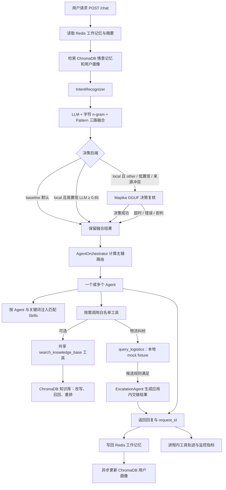

# 智能客服系统业务流程

本文按一次客服请求的真实调用顺序说明意图识别、协同路由、工具使用、记忆、升级和回退。物流纠纷与技术、账单和通用客服共用同一运行时。

## 一次请求如何完成

决策器仅在 local 模式启用。baseline 使用 LLM 0.7、字符 n-gram 向量 0.2、关键词规则 0.1 进行融合；当前 Anthropic SDK 没有此处使用的 Embedding 资源，意图向量分支使用本地 256 维字符 n-gram 哈希，不是预训练语义模型。此分支与 ChromaDB 默认 ONNX Embedding（RAG 与记忆检索）互相独立。决策器只有在未失败的 LLM 置信度低于 ECHOMIND_LLM_PRIORITY_CONFIDENCE（默认 0.85）时才可能介入。低于 ECHOMIND_DECISION_TRIGGER_CONFIDENCE（默认 0.65）、融合结果为 other 或多路结果冲突时调用。异常、超时、拒判或标签不合法时沿用三路融合结果。Mapika 模型分数作为独立来源信号，不与其他分数直接比较。

## 细粒度意图与业务边界

| 意图 | 处理方式 |
|---|---|
| logistics、order_status | 普通订单/物流咨询由 GeneralAgent 处理 |
| logistics_lost | 疑似丢件、补充运单号与核验线索 |
| logistics_damaged | 破损、错发或少件，整理可提供的证据 |
| logistics_dispute | 页面签收状态与用户实际收货情况不符 |
| logistics_delay | 轨迹停滞或预计送达时间已过 |
| logistics_address | 询问地址更改方式；不会直接改动订单或承运商记录 |
| technical_login、technical_crash、technical | TechnicalAgent 排障 |
| refund、invoice、payment_issue、account、account_security、billing | BillingAgent 核验和说明 |
| human_handoff、escalation 或 CRITICAL 紧急度 | EscalationAgent 生成交接结果 |
| 其他一般咨询、低置信度 other | GeneralAgent；必要时先澄清 |

五类物流纠纷意图映射到 LogisticsAgent。该 Agent 的职责包括识别纠纷类型、确认运单号、整理证据、查询本地演示数据、解释边界并判断是否需要交接。缺少运单号时先追问；规则实体抽取识别“运单号”“快递单号”“物流单号”“tracking no”等字段。

## 主 Agent、辅助 Agent 与并行协作

路由综合意图、领域关键词、结构化实体和可用 Agent 状态计算各领域分数。主 Agent 负责主要诉求；明确命中的其他专业领域可加入 supporting_agents，由多个 Agent 并行处理后合并答复。物流纠纷、退款等复合请求可同时覆盖 Logistics 与 Billing；登录故障和重复扣款可同时覆盖 Technical 与 Billing。

routing_reason、routing_confidence、primary_agent、supporting_agents 和 agent_types 会随 /chat 响应返回。CRITICAL 和明确转人工意图优先进入 EscalationAgent。Monitor 达到降权条件的专业 Agent 会从当次候选中移除；没有可用的专业 Agent 时路由回退到 General。专业 Agent 执行失败时也有 General 兜底路径。

## 物流本地模拟与交接规则

query_logistics 只读取仓库内 data/mock_logistics.json。工具结果的 source 固定为 local_mock，没有网络请求或真实快递 API 调用。结果只代表 fixture 内容，不代表实际承运商轨迹、签收状态或理赔资格。

物流升级候选默认同时满足以下条件：

1. 当前意图为 logistics_lost；
2. 本地模拟记录的 days_without_update 大于或等于 ECHOMIND_LOGISTICS_LOST_DAYS_THRESHOLD（默认 7）；
3. 最近五条历史消息中，符合当前物流意图关键词的用户消息数大于或等于 ECHOMIND_LOGISTICS_MIN_FOLLOWUPS（默认 2）。

历史消息没有可信时间戳，代码使用消息条数近似“频繁追问”；该值是可配置的演示规则，不是承运商政策。条件满足时，LogisticsAgent 的结果后附 EscalationAgent 的应用内交接说明，并在响应中标记 escalated=true。显式要求人工或其他 CRITICAL 场景也会走升级路径。当前没有工单、人工队列、Webhook 或真实物流平台集成；交接结果供应用展示和后续系统对接使用。

物流资料 data/demo_docs/logistics_demo_policy.md 明确标注为模拟说明。可通过 /knowledge/upload 导入演示检索；不要把它描述为真实快递公司、平台或法律规则。

## 工具与按需 RAG

每个 LLM-backed Agent 只能调用自己的工具白名单，并可使用共享知识检索工具：

| Agent | 专属工具示例 | 共享工具 |
|---|---|---|
| GeneralAgent | inspect_request_context、suggest_required_fields | search_knowledge_base |
| TechnicalAgent | lookup_error_code、build_diagnostic_plan | search_knowledge_base |
| BillingAgent | check_billing_fields、compare_amounts | search_knowledge_base |
| LogisticsAgent | query_logistics | search_knowledge_base |
| EscalationAgent | 当前直接生成交接信息 | 当前处理路径不调用检索工具 |

/chat 在 Agent 主链路中提供 search_knowledge_base 工具，由 Agent 判断当前问题是否需要查询。API 层不按意图提前检索，检索内容也不会无条件注入提示词。调用检索工具后，MCP ToolManager 可执行查询改写、并行召回、去重、重排和缓存；工具错误时按配置返回可解释的回退结果。POST /search 用于独立检查检索质量。

Skills 与 RAG 用途不同：Skill 规定处理流程、问法和禁止事项；知识库提供具体业务材料。四个内置 Skill 按 agents 与 keywords 匹配，内容按预算注入支持 LLM 的相应 Agent 系统提示，支持 /skills/reload 热加载。EscalationAgent 当前走确定性交接输出，不执行 LLM prompt。

## 记忆与上下文

| 层 | 存储 | 内容与用途 |
|---|---|---|
| 当前会话工作记忆 | Redis，24 小时 TTL | 最近消息；参与对话上下文和最多最近 5 条识别历史 |
| 会话摘要 | Redis | 工作记忆达到 15 条时，压缩较早消息并保留最近 5 条 |
| 情景记忆 | ChromaDB episodic | 压缩摘要，可按当前查询做语义检索 |
| 用户画像 | ChromaDB user_profile | 异步提炼的偏好和常见实体 |
| 业务知识 | ChromaDB knowledge_base | Agent 通过 RAG 工具按需检索 |

当前请求完成后，用户与助手消息写回工作记忆，随后异步更新用户画像。ChromaDB 服务不可用时，记忆层会尝试本地嵌入式持久化模式；检索和存储异常会写日志并按实现退化。

## 工具轨迹、监控与评测

/chat 返回 request_id、实际参与 Agent、工具名、路由原因、识别来源及耗时。调用 GET /trace/tool/{request_id} 可查看本进程缓存的参数、状态、耗时、缓存/重排标志及结果元数据；运单号在工具轨迹中会脱敏。轨迹默认只保留最近 200 条，并非持久化审计日志。

/monitor 提供 Agent/工具成功率、平均耗时、熔断状态、告警和优化建议；Monitor 可通过路由惩罚使故障 Agent 暂停接收新请求。/metrics 提供 Prometheus 抓取指标。/eval/run 运行在线意图和对话评测、LLM-as-Judge 与回归检查，并会更新 EVAL_BASELINE_PATH 指向的回归基线文件。固定离线评测集及历史报告位于 data/eval/；离线 benchmark 不等同于 /chat 端到端性能测试。

## 主要异常与回退

- 本地决策器不可用、拒判、超时或结果无效：保留 baseline 意图。
- 专业 Agent 不可用、被 Monitor 降权或执行失败：按路由状态使用可用 Agent 或回退 GeneralAgent。
- 知识库工具或 ChromaDB 不可用：检索工具返回失败/回退信息供 Agent 处理。
- 缺少物流运单号：LogisticsAgent 直接追问，不猜测号码或调用真实平台。
- 模拟 fixture 中找不到运单：说明仅本地记录未命中，不能推断真实物流状态。
- 人工升级：输出应用内交接标记与摘要，不代表已创建工单或联系人工。
