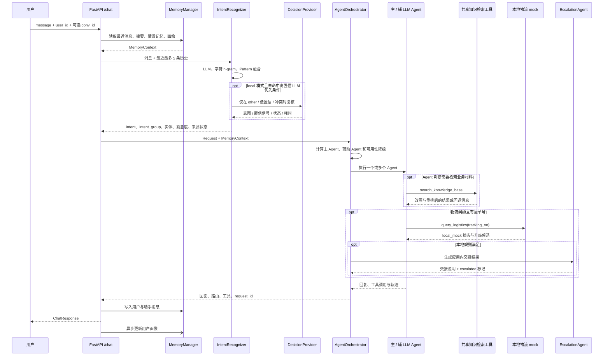
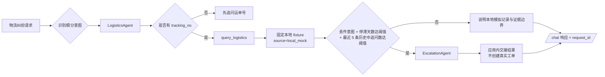
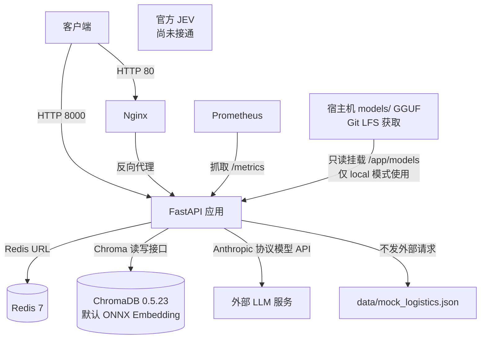

# 智能客服多 Agent 协同决策系统架构

以下图表描述当前 Python 后端的运行结构与请求数据流。名称和行为以 api/、core/、agents/、mcp/、memory/ 的现有实现为准。

## 总体架构

```mermaid
flowchart LR
    C[用户 / 客户端] --> N[Nginx 可选入口]
    N --> API[FastAPI]
    C --> API
    API --> CHAT[/chat]
    API --> OPS[health · docs · skills · search · knowledge · monitor · metrics · trace · eval]

    CHAT --> MEM[MemoryManager]
    MEM --> REDIS[(Redis<br/>工作记忆 / 摘要)]
    MEM --> CHROMA[(ChromaDB<br/>情景记忆 / 用户画像 / knowledge_base)]

    CHAT --> INT[IntentRecognizer]
    INT --> TRI[LLM + 字符 n-gram + Pattern]
    TRI --> BASE[baseline 默认融合]
    BASE --> DEC{local 复核条件}
    DEC -->|高置信 LLM 优先| ROUTE[AgentOrchestrator]
    DEC -->|other / 低置信 / 冲突| MAP[Mapika GGUF<br/>CPU 本地决策]
    MAP -->|成功或回退 baseline| ROUTE
    BASE -->|默认关闭 local| ROUTE

    ROUTE --> GEN[GeneralAgent]
    ROUTE --> TECH[TechnicalAgent]
    ROUTE --> BILL[BillingAgent]
    ROUTE --> LOG[LogisticsAgent]
    ROUTE --> ESC[EscalationAgent]

    GEN --> SK[SkillManager<br/>按 Agent 和关键词注入]
    TECH --> SK
    BILL --> SK
    LOG --> SK

    GEN --> TOOLS[LLM Agent 工具白名单]
    TECH --> TOOLS
    BILL --> TOOLS
    LOG --> TOOLS
    TOOLS --> RAG[共享 search_knowledge_base<br/>Agent 按需调用]
    RAG --> TM[MCP ToolManager<br/>改写 / 召回 / 重排 / 缓存 / fallback]
    TM --> CHROMA
    TOOLS --> FIX[query_logistics<br/>data/mock_logistics.json]
    FIX -->|local_mock 候选升级| ESC
    ESC --> HAND[应用内交接结果<br/>无真实工单集成]

    ROUTE --> TRACE[request_id 工具轨迹]
    ROUTE --> MON[Monitor 与 Prometheus]
    ROUTE --> API
    MEM --> API
```

## /chat 调用顺序



## 物流纠纷与人工交接



## 部署拓扑



Compose 服务端口：API 8000、Nginx 80、ChromaDB 8001、Redis 6379、Prometheus 9090。models/*.gguf 被 .dockerignore 排除，Compose 将权重目录只读挂载给应用容器。完整启动步骤和变量说明见[完整使用指南](完整使用指南.md)。
